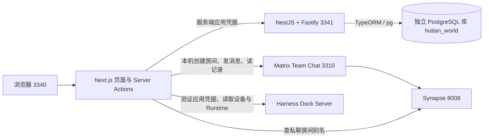

# 技术栈与第一段边界

2026-11-05。依据旧 hutian 的实际 package.json、数据库源码和界面组件，沿用其主栈，并按新产品边界重新实现。

| 部分 | 第一段采用 | 从旧工程保留的思路 |
| --- | --- | --- |
| Web | Next.js 16、React 19、Tailwind CSS 4 | App Router、服务端读取、工作台布局和主题 |
| UI | Radix / shadcn、assistant-ui、Lucide | 复用 `DESIGN.md`、主题 token、shadcn 注册表配置和旧共用组件；Beautiful UI 保留给真实工具状态 |
| 业务 API | NestJS 12 + Fastify 5 | 独立业务服务，Web 通过服务端凭据调用 |
| 私聊 | 本机 Matrix Team Chat + Synapse | 使用已有聊天身份、房间和消息存储；Web 只提供会话入口 |
| 运行环境 | Harness Dock 发布版 SDK 0.1.2 | 沿用旧版电脑目录；从 Dock 读取授权、设备连接和 Runtime 状态 |
| 数据 | TypeORM 1 + pg、PostgreSQL | EntitySchema、显式迁移，关闭自动同步 |
| 工程 | TypeScript 6、pnpm workspace | 同仓维护，内部共享输入契约 |
| 通用配置 | UnJS c12 | 读取项目私有 dotenv，复用社区实现 |

旧工程参考位置：`hutian/apps/web/package.json`、`hutian/apps/core-service/package.json`、`hutian/packages/core-db/src/client.ts` 和 `hutian/apps/web/src/components/ui/`。旧工程没有发生代码或数据库修改。

Web 使用当前核对的 Next 16 稳定补丁版本 16.4.5；其余主要框架沿用旧工程的已用版本。具体版本锁定在各 package.json 与 pnpm-lock.yaml。TypeScript 使用稳定 6.0.3，避免沿用旧应用的开发预览编译器。pnpm 自身完成工作区构建排序，本段无需增加任务调度器。

官方能力依据：[Next.js Route Handlers](https://nextjs.org/docs/app/getting-started/route-handlers)、[NestJS Fastify 适配](https://docs.nestjs.com/techniques/performance)、[TypeORM 数据源配置](https://typeorm.io/docs/data-source/data-source-options/)、[shadcn Dialog](https://ui.shadcn.com/docs/components/radix/dialog)。这些文档支持框架用法，不代替本机运行结果。

## 数据归属

- `creators`：当前本地创造者的稳定身份；首次启动插入本地配置中的 ID。
- `projects`：项目名称、目标、归属及时间。
- `roles`：持续角色的名称、职责、设定、归属及时间。
- `project_roles`：角色和项目的多对多关系，增减关联不改变角色 ID 或设定。
- TypeORM 另有一张迁移记录表。

接口的创造者范围由服务端配置确定，不接受浏览器提交 creatorId。后续接入账号后按登录身份和项目授权替换这一入口；当前没有多人登录、邀请、跨创造者协作或完整业务授权。

私聊按当前创造者和现有 Matrix 聊天对象解析稳定的房间别名，重复打开时使用同一会话；发送前核对房间的两位成员。别名解析使用 [Matrix 房间别名接口](https://spec.matrix.org/latest/client-server-api/#get_matrixclientv3directoryroomroomalias)；聊天记录保存在 Matrix。当前聊天对象来自本机 Matrix Team Chat 配置，和 hutian 持续角色尚未绑定。

运行环境采用 [Dock 发布版 SDK](https://hutian-ai.github.io/harness-dock/sdk/)。Hutian 保存一份本机私有应用凭据，连接并读取状态后关闭。设备授权、在线状态、Runtime 目录与模型都由 Dock 返回。应用凭据同一时间只允许一个活动连接；如果与另一个本机模块使用同一凭据，应等它结束后刷新。后续独立部署使用管理员分配的凭据和设备，不把旧 Hutian 的配对桥接搬过来。

文档索引、记忆、原运行等事实留在既有服务。任务、交接、验收以及后续接入按实际页面场景逐段加入。

## 验证方式

采用必要的类型检查、构建和最短真实浏览器操作。原始结果留在 `.local/`，不新增测试代码、测试框架、fixture 或 CI。
