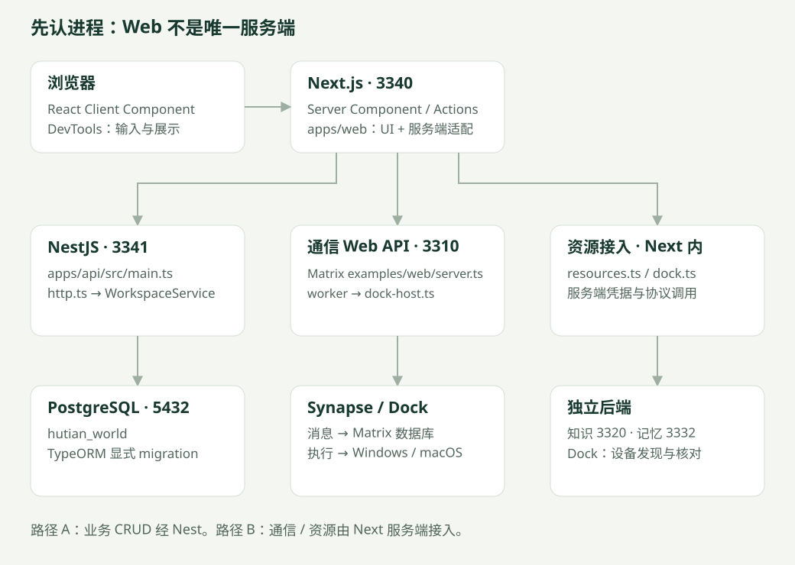
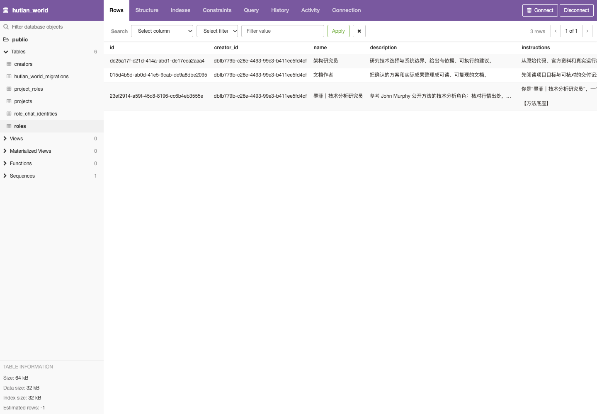
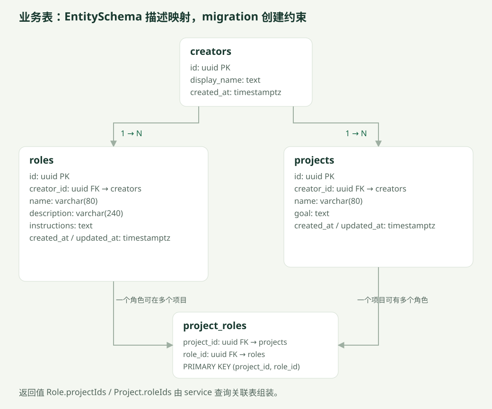
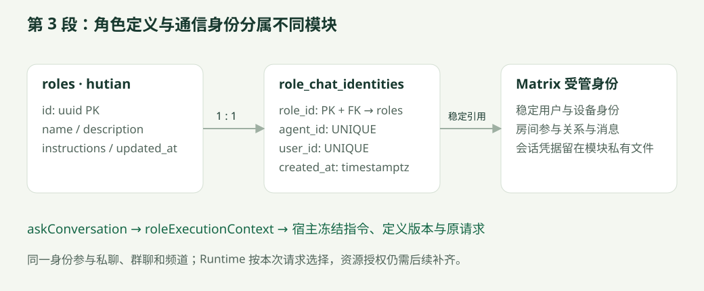
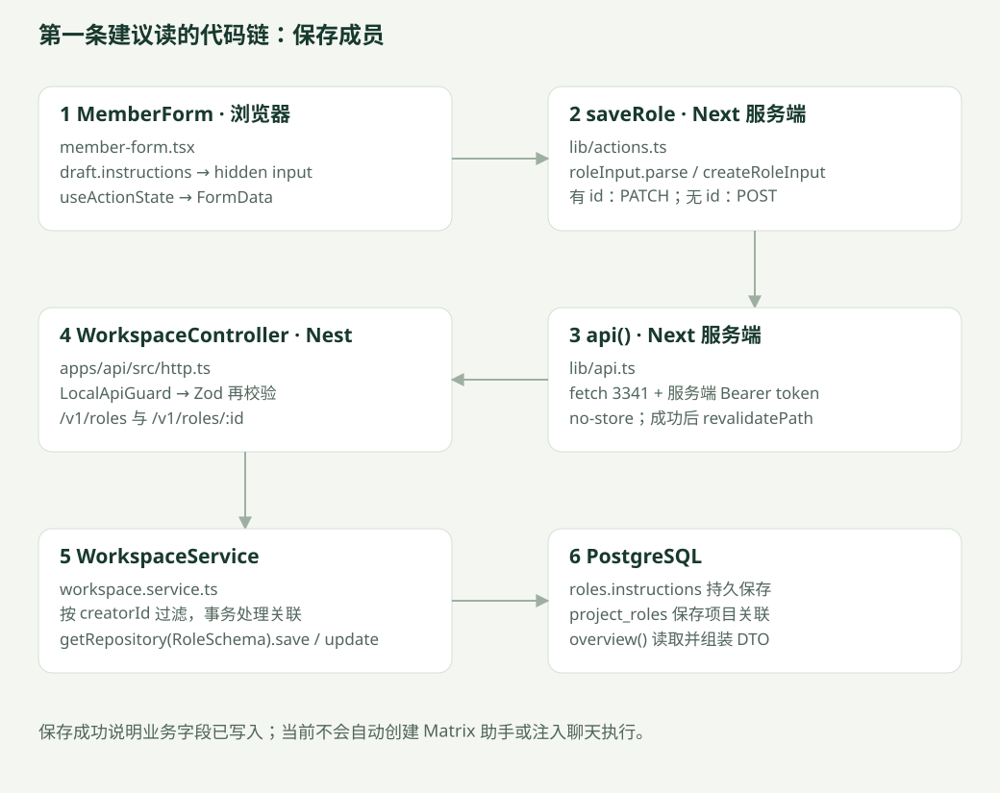
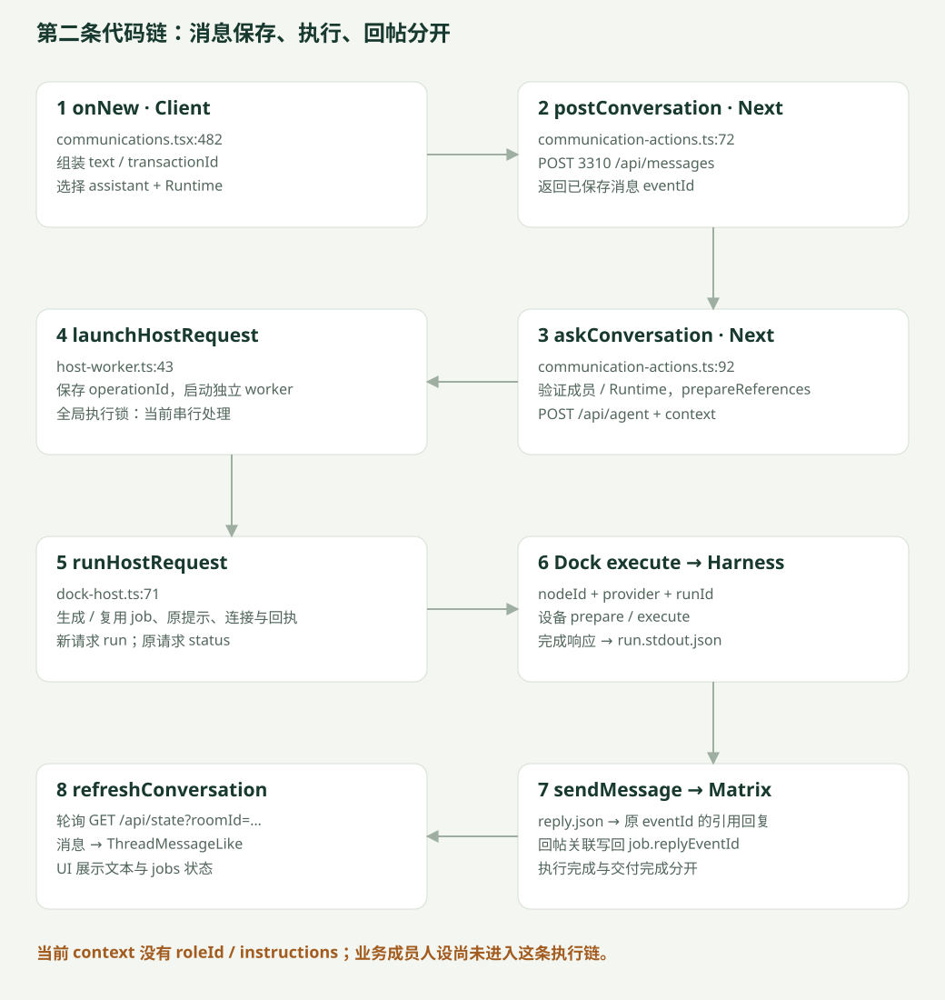
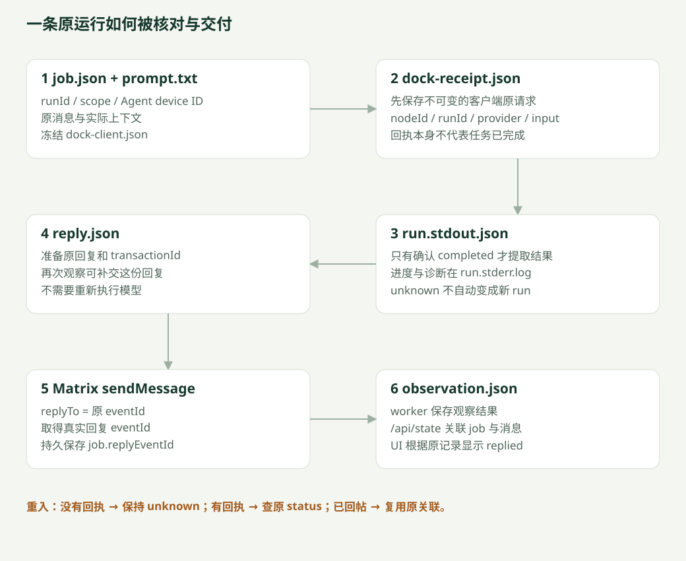

# hutian 开发接手手册

目标：你打开工作区后，知道怎样启动和调试、从哪个函数读起、数据存在哪里，以及改功能需要经过哪些文件。本文对应 **2026-11-13 第 3 段源码与运行环境**，角色正式关联和人设注入已接通，真实范围见 [第 3 段交付](../stage-3.md)。产品流程移至 [流程附录](product-overview.html)。

**2026-11-14 第 4 段补充**：角色私有和会话共享资源已接入，接口入口与代码见 [第 4 段交付](../stage-4.md)、`resource-scopes.ts`、`resource-provisioning.ts`。下文保留第 3 段的链路讲解；当前不再把工作台所有资源直接提供给角色，数据库表结构没有新增。

**最短阅读路线**：第 2 节看进程和文件，第 3 节看表，第 4、5 节跟一次写入与执行，第 9 节照着做第一个小改动。源码链接带文件和行号；浏览版点击后会复制 `绝对路径:行号`。

| 接手时的问题 | 直接去哪里 |
| --- | --- |
| 改了代码，页面为什么没变？ | 第 1 节：开发进程与正式构建 |
| 墨菲的人设存在什么表，谁负责写？ | 第 3、4 节：`roles.instructions` 与 CRUD |
| 发消息为什么没有经过 Nest API？ | 第 2、5 节：Next Server Actions 直接接通信宿主 |
| 一个请求怎样落到 Windows？ | 第 5、6 节：`askConversation` → worker → Dock |
| 怎么对照真实数据？ | 第 3 节：[本机只读数据库面板](http://127.0.0.1:3343/) |
| 第一次改动从哪里下手？ | 第 9 节：消息时间显示、改表顺序与角色绑定实现 |

## 1. 启动开发进程与调试

```sh
cd /Users/xuan/Documents/hutian-ai/hutian-world
```

Web 在 `3340`、业务 API 在 `3341`、通信模块在 `3310`。数据库、知识与记忆另有容器。当前 Web 使用 `next start` 的正式构建；要使 TSX 修改立即更新，需要切换为 `next dev`。

先看端口占用：

```sh
lsof -nP -iTCP:3340 -iTCP:3341 -iTCP:3310 -sTCP:LISTEN
```

在持有旧进程的终端停止对应 Web / API，再启动开发命令。不要照抄历史 PID，也不要停止数据库来解决 Web 端口冲突。

```sh
pnpm dev
```

这个脚本先构建 contracts，再并行运行 `next dev` 和 `tsx watch src/main.ts`。它不会自动启动 Matrix、Dock、Hindsight 或 AnythingLLM。

首次取得仓库、尚未准备环境时才做：

```sh
pnpm install
pnpm setup:local
pnpm db:migrate
pnpm dev
```

现有 `.local/app.env` 和数据库要保留。`setup:local` 发现已有配置会保留；缺少配置但遇到同名数据库时不会重置。另一台电脑安装见 [仓库 README](../../README.md)。

| 命令 | 实际做什么 |
| --- | --- |
| `pnpm dev` | 构建 contracts，启动 Web / API 开发进程 |
| `pnpm build` | 按 workspace 依赖顺序生成正式产物 |
| `pnpm start` | 启动已构建产物，不自动重新构建源码 |
| `pnpm db:migrate` | 执行尚未应用的显式 TypeORM migration |
| `pnpm --filter @hutian-world/web typecheck` | 只检查 Web 的 TypeScript |
| `pnpm --filter @hutian-world/api typecheck` | 只检查 API 的 TypeScript |
| `pnpm typecheck` | 构建 contracts，再检查全部内部包 |

contracts 通过 [package.json](../../packages/contracts/package.json) 导出 `dist/index.js` 与声明文件。只做类型检查不生成新产物；修改后运行 `pnpm --filter @hutian-world/contracts build`，必要时重启开发进程。

调试时，浏览器 DevTools 对应 Client Component；Server Actions 属于 Next Node 进程；Nest service 属于 API Node 进程。后两者需要为对应启动进程开启 Node inspector，再用编辑器 Attach。当前未预置统一调试启动配置。

停止普通 Web / API 后，可分别在两个终端用以下方式替代启动。Web 的 `--inspect` 已核对当前安装的 Next CLI 支持；API 命令为单进程调试，不带 watch。

```sh
# 终端 A：hutian-world 根目录
pnpm --filter @hutian-world/web dev --inspect=127.0.0.1:9229

# 终端 B：hutian-world/apps/api
node --inspect=127.0.0.1:9231 --import tsx src/main.ts
```

在 `saveRole` / `askConversation` 断点附加 Web inspector；在 `WorkspaceService.updateRole` 断点附加 API inspector。以启动终端实际打印的调试地址为准。断住服务端操作会影响超时，调试结束后再测正常延迟。

## 2. 目录、进程和两条服务端路径



*图 1：Next 服务端直接接通信、知识、记忆和 Dock 发现；不是所有请求都经 Nest 转发。*

```text
hutian-ai/
├─ hutian-world/                       当前新产品仓库
│  ├─ apps/web/
│  │  ├─ next.config.mjs               加载 .local/app.env
│  │  └─ src/
│  │     ├─ app/(workspace)/           App Router 页面与 layout
│  │     ├─ components/               客户端交互与 UI
│  │     └─ lib/                      Server Actions 与服务端适配
│  ├─ apps/api/src/                   Nest 路由、service、数据库
│  ├─ packages/contracts/src/         Zod 输入与共享返回类型
│  └─ .local/                        私有连接与实操证据
├─ matrix-team-chat/                  Matrix Agents Chat，保留历史目录名
│  ├─ src/                           Matrix SDK：房间、消息、历史
│  └─ examples/                      独立 Web API 与执行宿主
├─ harness-dock/                     设备和执行基础设施
└─ infra/                            PostgreSQL、知识、记忆部署
```

**路径 A，业务写入：** `MemberForm → saveRole → api() → Nest /v1/roles → WorkspaceService → PostgreSQL`。

**路径 B，通信执行：** `Communications → postConversation / askConversation → communicationRequest() → Matrix Web API → worker → Dock`。当前不经过 Nest 的 `WorkspaceService`。

接手时先区分这两条路径：消息执行控制器不在 Nest 中；给消息增加展示字段，也不一定需要改业务表。

### 为什么比旧 hutian 小很多

当前业务范围明显小于旧版，同时将部分底层实现交给独立模块。接手时要把这两种变化分开理解：

| 旧版的复杂度 | 新版当前处理方式 | 仍需要看清的边界 |
| --- | --- | --- |
| Core 集中处理通信、执行接入、资料和记忆 | 通过 Matrix、Dock、AnythingLLM、Hindsight 接入 | 复杂度仍存在于模块和上游服务，不能只数新业务库的表 |
| Actor 人设、运行上下文、通信与执行关联 | Role 已正式关联通信身份，执行时加载人设 | 本机角色 / 会话范围已接入，多人授权与完整会话连续性仍未完成 |
| Actor Turn、DBOS 恢复、worldline 投影、任务与日程 | 当前是人明确发起一次执行，宿主保存原请求与交付记录 | 尚未移植完整行为、工作流与恢复体系；不能认为几把文件锁覆盖了旧能力 |
| 多个领域包和完整工程检查 | 当前三个内部 workspace 包，按要求先打通最短路径 | 工程组织更轻不代表已经具备旧版全部业务能力 |

可对照旧版 [AppModule](../../../hutian/apps/core-service/src/app/app.module.ts)、[DBOS 工作流](../../../hutian/apps/core-service/src/platform/dbos/durable-world.ts) 和 [会话执行上下文](../../../hutian/apps/core-service/src/modules/communication/conversation-runtime-input.ts)。旧代码会生成角色指令并区分上下文继续方式；新版第 3 段已通过 roleExecutionContext 加载正式角色定义，但没有移植完整 Actor Turn 与原生 session 连续性。

当前是本机单创造者的角色聊天版本。私聊、群聊和频道的角色身份与人设已在真实调用中核对；资源范围与完整执行过程仍需补齐。业务协调规则归 hutian，Matrix 目录内的宿主接收通用输入，不代替角色业务层。

| 标记 | 当前用途 |
| --- | --- |
| 默认 Server Component | Next 服务端读取初始数据，传 props 给客户端组件 |
| `"use client"` | `communications.tsx` 管输入、选择项、轮询与展示 |
| `"use server"` | `communication-actions.ts` 导出可被 Client 调用的 Server Actions |
| `import "server-only"` | 防止接口适配与凭据模块进入客户端包；本身不创建路由 |

`api.ts` 在服务端附加应用 token。浏览器调用 Server Action，不直接带 token 请求 Nest。`getWorkspace` 的 React `cache()` 用于请求内复用，配合 `no-store` 与动态 layout，不是一份持久业务缓存。

[chat/page.tsx](../../apps/web/src/app/(workspace)/chat/page.tsx#L9) 带 `peer` 参数时仍走早期 `DirectChat`；当前默认私聊 / 群聊 / 频道走 `room` 分支和 `Communications`。不要从旧分支开始追新界面的执行链。

Web 的 `@harness-dock/client` 来自发布的 SDK tarball，不是本 workspace 的本地 Dock 包。修改相邻 `harness-dock` 源码不代表 Web 自动使用了新版本；先看依赖来源，不直接改 `node_modules`。

## 3. 数据库表与 TypeScript 模型

[打开数据库面板](http://127.0.0.1:3343/)，默认 `hutian_world`，左侧选择 `roles`。面板使用专用只读账号。



*图 2：数据库面板的 roles 快照。第 3 段当前有 6 张业务表和 1 张迁移记录表，新增 role_chat_identities 与 role_runtime_bindings；截图早于执行配置补充。角色、项目及关联数量是截图时的快照。*



*图 3：原四张业务表；第 3 段新增通信身份映射见下图。`Role.projectIds` 与 `Project.roleIds` 是 service 组装字段，不是主表数组列。*



新表由 [role-chat migration](../../apps/api/src/database/role-chat.ts) 创建。role_id 是 roles 外键及主键，agent_id 和 user_id 各自唯一；`WorkspaceService.bindRoleChat` 按拥有者范围锁定角色并保存关联。API 返回的 `Role.chatIdentity` 来自此表。

成员默认 Runtime 另存于 `role_runtime_bindings`，由 [role-runtime migration](../../apps/api/src/database/role-runtime.ts) 创建。`role_id` 关联角色，`node_id + provider` 指定电脑与 Harness，`label` 是保存时的公开名称快照，`updated_at` 是执行配置自己的修订时间；不会修改 `roles.updated_at` 或人设版本。未设置默认时没有对应记录。

从 [RoleRuntimeForm](../../apps/web/src/components/role-runtime-form.tsx) 读起：`saveRoleRuntime` 在 Next 服务端核对当前设备与 Harness，再调用 `PUT /v1/roles/:id/runtime`。Nest 核对拥有者、锁定角色，并比较 `expectedUpdatedAt`，避免其他页面的旧配置覆盖新值。模型、推理强度与权限仍由执行端管理。

| 文件 | 作用 |
| --- | --- |
| [contracts/index.ts](../../packages/contracts/src/index.ts#L1) | 输入 Zod 与返回类型，例如人设输入最长 20,000 字符 |
| [database/schema.ts](../../apps/api/src/database/schema.ts#L1) | `EntitySchema`：TS 字段、SQL 列名和类型映射 |
| [database/initial.ts](../../apps/api/src/database/initial.ts#L1) | 建表 SQL：主键、外键、非空约束和索引 |

例如 `RoleRecord.creatorId` 对应 `roles.creator_id`，`createdAt / updatedAt` 对应 `timestamptz` 列。service 对外返回时把 `Date` 转 ISO 字符串。

在 Query 页运行这些只读 SQL，并对照模型：

```sql
SELECT id, name, description, length(instructions) AS instruction_chars,
       created_at, updated_at
FROM roles
ORDER BY updated_at DESC;

SELECT r.name AS role_name, p.name AS project_name
FROM project_roles pr
JOIN roles r ON r.id = pr.role_id
JOIN projects p ON p.id = pr.project_id
ORDER BY r.name, p.name;

SELECT name, timestamp
FROM hutian_world_migrations
ORDER BY timestamp;
```

`HUTIAN_CREATOR_ID` 是私有配置中的稳定创造者 ID，service 据它过滤拥有者范围；不是用户登录系统。API Bearer token 也不等于完整的多用户身份认证。

| 业务库之外的数据 | 所在位置 |
| --- | --- |
| 消息、房间、参与关系 | Synapse 的 `matrix_chat`，通过 Matrix 接口操作 |
| 宿主请求、提示、回执与交付记录 | Matrix `.local/host-worker`、`.local/agent-host` 文件 |
| 知识原文与索引 | 私有 library 文件 + AnythingLLM 的 `hutian_knowledge` |
| 记忆来源与整理结果 | Hindsight 的 `hutian_memory`，经 Memory Access 调用 |
| 设备原运行、原生 session | Dock / 执行设备，业务库没有复制完整账本 |

面板可切换数据库。能查看上游的表不代表应直接修改其内部结构；业务行为仍通过模块接口完成。

## 4. 成员保存的完整代码链

这是最适合先读的同步路径：输入明确、表少，UI 与 SQL 能直接对照。



*图 4：按 Client、Next 服务端、Nest 和 PostgreSQL 四段读。*

### 表单与 Server Action

读 [member-form.tsx](../../apps/web/src/components/member-form.tsx#L25)。`draft` 是编辑态，`saved` 用来判断未保存修改。人设编辑器更新 `draft.instructions`，hidden input 将它放入 `FormData`。

`useActionState` 调 `saveRole`；成功后更新 saved 状态，创建成员再导航到新成员页。读 [actions.ts](../../apps/web/src/lib/actions.ts#L27)：

```ts
const input = roleInput.parse({
  name: form.get("name"),
  description: form.get("description"),
  instructions: form.get("instructions"),
});
```

有 `id` 走 `PATCH /v1/roles/:id`，没有走 `POST /v1/roles`；创建可带 `projectId`。`api.ts` 执行 fetch 并附加服务端 token。成功后 `perform` 调 `revalidatePath("/", "layout")`。

### Nest 与 TypeORM

读 [http.ts](../../apps/api/src/http.ts#L36)：全局 Guard 验证应用 token，控制器再次用 Zod 校验，再调 service。Server Action 的校验服务于页面错误提示，业务 API 仍需要独立校验。

读 [workspace.service.ts](../../apps/api/src/workspace.service.ts#L36)：

```ts
const result = await this.db.getRepository(RoleSchema).update(
  { id, creatorId: this.creatorId },
  input,
);
```

更新条件同时包含角色 ID 与创造者 ID。创建时若带项目，在一个事务里确认项目归属、插入角色、插入关联；移除关联不会重建或删除角色。

`overview()` 用 `Promise.all` 读取基础记录，再查询 `project_roles`，组装返回的 roleIds / projectIds。此处没有把角色自动同步为 Matrix 助手。

## 5. 聊天到 Windows 的完整代码链



*图 5：roomId 选房间，eventId 引用已保存消息，agentId 选通信助手，nodeId + provider 选 Runtime，runId 标识一次执行。*

### 页面与消息状态

[chat/page.tsx](../../apps/web/src/app/(workspace)/chat/page.tsx#L9) 先读取目录和房间初始状态，再传给 [Communications](../../apps/web/src/components/communications.tsx#L334)。重点读同一文件的三个位置：

- `messages`：Matrix 消息转 `ThreadMessageLike`，包含 `createdAt: new Date(m.timestamp)` 和 jobs 元信息。
- `useExternalStoreRuntime`：assistant-ui 使用外部消息源。
- `onNew`：防重、保存消息、请求助手和刷新。

页面约每 2.5 秒查询状态。localStorage 只保存当前浏览器的助手、临时 Runtime 与资源开关偏好；成员默认保存在业务库。临时选择与成员执行配置修订时间关联，默认改变后不再沿用旧浏览器选择。选择“成员默认”时浏览器只提交 `runtimeMode: "member"`，`askConversation` 从服务端读取当前绑定并核对在线状态；原运行的查询仍沿原回执进行。

### 先写消息，再请求执行

读 [postConversation](../../apps/web/src/lib/communication-actions.ts#L91) 与 [askConversation](../../apps/web/src/lib/communication-actions.ts#L111)。流程摘写如下，省略错误处理：

```ts
const sent = await postConversation({
  roomId: selectedId, text, transactionId: transaction.id,
});
if (agentId && sent.ok) {
  await askConversation({
    roomId: selectedId,
    eventId: sent.eventId,
    agentId,
    runtime: { nodeId, provider },
    useKnowledge,
    useMemory,
  });
}
```

执行失败时消息可能已成功保存，所以需要分别处理这两个结果。`askConversation` 先确认房间、助手与人类消息，再用 `getDockDevice` 验证设备和 Provider，之后才检索与派发。

### 通信 HTTP 契约

[communications.ts](../../apps/web/src/lib/communications.ts#L1) 用 Zod 解析宿主返回值，`communicationRequest` 调用 `3310`。下面是 Matrix 独立服务路由，不属于 `3341` Nest：

| 方法与路径 | 用途 |
| --- | --- |
| `GET /api/rooms` | 房间与助手目录 |
| `POST /api/rooms` | 按原 transaction ID 创建房间 |
| `POST /api/agents` | 明确创建或更新受管助手，复用原身份和设备 |
| `GET /api/state?roomId=...` | 消息、成员、jobs、active |
| `POST /api/messages` | 保存人类消息并返回 eventId |
| `POST /api/agent` | 指定助手处理指定消息 |
| `POST /api/agent/resume` | 观察原运行并补交结果，不重新派发 |

派发请求结构如下，ID 使用占位符：

```json
{
  "roomId": "!matrix-room-id",
  "eventId": "$matrix-event-id",
  "agentId": "configured-agent-id",
  "context": {
    "nodeId": "authorized-device-uuid",
    "provider": "codex",
    "connectionId": "workspace",
    "material": "检索片段、版本与来源",
    "instructions": "由 hutian 服务端读取并构造的角色身份、职责与人设",
    "instructionsVersion": "定义时间#内容hash",
    "instructionsLabel": "本次成员名称",
    "instructionsSource": "hutian://roles/role-uuid"
  }
}
```

`askConversation` 根据 agentId 查询正式绑定，核对当前 Matrix 身份，再从服务端读取 Role。`roleExecutionContext` 生成指令与定义 hash；浏览器不提交任意人设来替代正式配置。版本、来源和所选 Runtime 随原 job 保存。实现入口是 [role-chat.ts](../../apps/web/src/lib/role-chat.ts)。

私聊按创造者与对方 Matrix 身份生成稳定别名，重复打开复用原房间；群聊 / 频道按当前操作 ID 创建。频道目前是邀请制长期主题房间。

## 6. 宿主、防重和执行状态

执行宿主虽位于 Matrix 仓库的 `examples/`，却是当前 hutian 实际调用的实现。

### 进程与锁

读 [server.ts](../../../matrix-team-chat/examples/web/server.ts#L234) → [launchHostRequest](../../../matrix-team-chat/examples/host-worker.ts#L43) → [runHostRequest](../../../matrix-team-chat/examples/dock-host.ts#L71)。Web 记录操作并启动独立 worker，由 worker 持有执行与交付过程。

当前有启动记录短锁、worker 全局执行锁、原消息 job 锁和持有 Dock 应用连接的宿主锁。助手请求串行处理，忙时拒绝其他请求，不是持久任务队列。

### 一次执行的私有文件



*图 6：先保存回执不单独证明设备已受理或执行完成。*

```text
matrix-team-chat/.local/
├─ host-worker/
│  ├─ <operationId>.json             启动操作与所选上下文
│  ├─ <operationId>.result.json      worker 观察结果
│  └─ active.json                   需结合有效执行锁判断存活
└─ agent-host/<scope-hash>/
   ├─ job.json                       runId、scope、Agent device ID、replyEventId
   ├─ dock-client.json               本次冻结的私有连接
   ├─ prompt.txt                     本次实际提示，私有
   ├─ dock-receipt.json               原请求与 runId
   ├─ run.stdout.json                最终执行响应
   ├─ run.stderr.log                 原生进度与诊断
   ├─ reply.json                     待交付文本和 transaction ID
   └─ observation.json               对原请求的观察记录
```

`jobLocation` 由 homeserver、助手 Matrix 身份、roomId、eventId 哈希生成 scope，区分不同助手处理同一消息。job 另核对助手 device ID，身份改变后不会直接接管旧请求。

### 为什么 unknown 时不能重新 run

已有 job 但没有回执时返回 unknown，不推断未执行。已有回执则后续用 status 查询原运行；已有 reply.json 可尝试交付原回复，已有 replyEventId 则复用关联。

`completed` 与 `replied` 不同：前者表示执行完成、回复待核对；后者表示已取得 Matrix 回帖关联。running、failed、cancelled、unknown 也分别处理。

宿主每次新请求读取最近最多 30 条房间历史，并限制约 32,000 字符上下文；没有将 Matrix 房间绑定为持续的原生 Codex thread。这里的 resume 不是原生 session 的继续执行。

工作台连接改变后，旧运行仍使用冻结的连接和原回执查询，不重定向到新设备。网页重开可查看原记录，但不保证宿主、Dock 或设备任意故障时都能继续执行。

## 7. 知识与记忆的具体接入

入口：[resource-workspace.tsx](../../apps/web/src/components/resource-workspace.tsx) → [resource-actions.ts](../../apps/web/src/lib/resource-actions.ts) → [resources.ts](../../apps/web/src/lib/resources.ts)。界面管理表单与状态，后两层运行在 Next 服务端。

### 知识的原文与索引

读 [saveKnowledge](../../apps/web/src/lib/resources.ts#L223)：

1. 用文档 UUID 保存私有 library 的 `<id>.json`，含 title、content、createdAt、status。
2. 同 ID 只接受完全相同内容，不覆盖为另一份资料。
3. 调 AnythingLLM `POST /api/v1/document/raw-text`，传 textContent、workspace 与稳定 docSource。
4. 确认成功标记 ready；无法确认则 unknown，原文保留，暂不参与检索。

`searchKnowledge` 调 `POST /api/v1/workspace/<workspace>/vector-search`，再按本地记录的 docSource、title 或 upstream ID 筛选所属文档，输出 Reference。当前还未完成一般资料编辑 / 删除。

### 记忆的范围与异步操作

读 [remember](../../apps/web/src/lib/resources.ts#L137)、[memoryOperation](../../apps/web/src/lib/resources.ts#L159)、[searchMemory](../../apps/web/src/lib/resources.ts#L167)：

```text
POST /v1/resources/<resource>/memories
  document_id + operation_id + content
  source_uri + source_version + evidence_status

GET  /v1/resources/<resource>/operations/<operationId>
POST /v1/resources/<resource>/recall
GET  /v1/resources/<resource>/documents/<documentId>
```

remember 提交异步整理，UI 观察原操作，完成后才可召回。召回条目可能没有 document_id；沿 source_fact_ids → source_facts 找来源文档，再生成原文链接。

服务端授权在 [Memory Access app.py](../../../infra/memory/access/hutian_memory_access/app.py)：按 resource 授权，再映射上游 bank。当前 Web 分个人工作台、角色私有和会话共享范围，角色私库仅用于对应两人私聊；项目和跨创造者授权尚未接入。

### 执行前组装材料

[prepareReferences](../../apps/web/src/lib/resources.ts#L312) 输出 `{ references, material }`：references 给 UI，material 给宿主。材料包含片段、版本和来源，不是全库正文，更不替代正式角色指令或权限。

resources.ts 用 `process.cwd()` 定位 `.local`，正常 cwd 是 `apps/web`。不要从仓库根目录直接导入它，然后假设读取的仍是同一份配置。

## 8. 调试时查哪一层

| 症状 | 先查的位置 |
| --- | --- |
| 成员保存字段错误 | saveRole 的 Zod 结果 → Nest PublicErrorFilter |
| 保存后刷新内容不对 | WorkspaceService.overview → SQL 当前行 → 页面初始 props |
| 消息没出现在房间 | onNew → postConversation → /api/messages 的 eventId |
| 消息已保存但未执行 | askConversation 的成员 / Runtime 检查 → 宿主操作记录 |
| 一直正在处理 | 有效 worker 锁、原 job、回执与原生进度 |
| 已执行但无聊天回复 | run.stdout.json → reply.json → Matrix send → replyEventId |
| 检索无结果 | 开关 → ready / operation 状态 → search 返回 |
| Runtime 在线但执行失败 | 在线只是发现状态，继续核对原生执行结果 |

浏览器 Network 能看到 Next Server Action 请求；真正的 `3340 → 3310` 和 `3340 → 3341` 发生在服务端，不会完整显示在浏览器网络列表中。

API 有不带业务数据的健康检查：

```sh
curl --fail --silent http://127.0.0.1:3341/health
```

查私有操作时按 runId 找记录，只摘状态、阶段和错误；不要把整个配置、原提示或凭据打印进聊天与公共日志。

### Windows 132 秒案例

Matrix 消息到回复为 130.848 秒，浏览器约 132 秒观察到：宿主请求保存前 0.808 秒，请求到最终结果 129.876 秒，结果到 Matrix 回帖 0.164 秒。

原生 Codex 返回：

```text
Warning: Falling back from WebSockets to HTTPS transport. request timed out
```

先定位到 Dock 调用 / 原生执行长区间，再查 Windows 到模型服务的连接。此提示不是 hutian 到 Dock 的 WebSocket 报错；现有事件没有足够的分段时间戳，不能把整段都叫作推理时间或网络超时。

本次输出 19 token，输入 26,131（缓存 13,696），宿主提示约 1.6 KB。原生 Harness 会带自己的上下文；没有进一步盘点 Windows 私有资产，不能猜具体来自哪些文件。本次确认链路与异常，没有修改 Windows 配置或宣称修复延迟。

## 9. 接手后的第一笔改动

### 不改表的小功能：显示消息时间

可以用它读懂数据转换与 UI。本教程没有自动把功能加进产品。

1. `communications.ts` 的消息已有 `timestamp: number`。
2. `communications.tsx` 已映射为 `createdAt: new Date(m.timestamp)`。
3. 在 AssistantMessage / UserMessage 使用这份时间显示，不用渲染时的当前时间。
4. 不改 Matrix 正文，不新增消息时间列。

组件写法示意，接入前按实际类型与页面样式调整：

```tsx
function MessageTime() {
  const at = useAuiState((s) => s.message.createdAt);
  if (!at) return null;
  return (
    <time dateTime={at.toISOString()}>
      {new Intl.DateTimeFormat("zh-CN", {
        hour: "2-digit", minute: "2-digit",
      }).format(at)}
    </time>
  );
}
```

接进两个消息组件，做 Web 类型检查，再看真实消息切换房间和刷新后时间是否保持。UI 开发先读 [DESIGN.md](../../DESIGN.md) 与 [UI 工作约定](../../.agents/skills/hutian-world-ui/SKILL.md)。不默认新增测试框架。

### 真要改表时

以未来新增成员字段为例，先确认它属于角色正式数据，再依次处理：

1. contracts 的输入规则、返回类型和创建 / 更新语义。
2. EntitySchema 的字段与 SQL 映射。
3. 新 migration 的增量 SQL，并在 database/source.ts 注册；不修改已应用的 initial migration 来代替升级。
4. service 默认值、拥有者范围、事务和序列化。
5. Web 表单、展示、错误与保存后刷新。
6. 执行 db:migrate、相关编译，再走真实保存路径。

`dataSource` 设置 synchronize:false、migrationsRun:false。API 检测到待迁移时停止并要求先 migrate，不会启动时默默改表。

### 已实现案例：角色绑定

“墨菲真正使用保存的人设回复”在第 3 段采用以下业务链：

- 角色与 Matrix 身份的关联由 hutian 业务层拥有。
- askConversation 按正式角色与授权加载 instructions，不相信浏览器任意传入的角色指令。
- 本次身份与指令版本随原请求保留，人设修改影响后续新请求。
- 在“成员 → 设置 → 执行配置”切换默认电脑与 Harness，聊天可临时覆盖；修改默认保留角色和人设版本，已经开始的原运行继续沿原回执查询。

上述身份关联、服务端加载和原请求快照已在第 3 段接通。原生 session 连续恢复和跨创造者资源授权还需后续实现，不从这次接入推断已经具备。

## 10. 配置与当前约束

| 文件 | 使用者与作用 |
| --- | --- |
| hutian-world `.local/app.env` | Next / Nest：API、应用 token、数据库 URL、创造者 ID |
| `.local/dock-client.json` | 应用连接凭据，不是设备配对文件 |
| `.local/memory-client.json` | 范围记忆调用凭据 |
| `.local/knowledge-client.json` | 知识接入与原文 library 位置 |
| Matrix `.local/host-connections.json` | 宿主允许的连接别名与私有文件映射 |
| Matrix `.local/agents.json` 与宿主配置 | 已接入助手身份与固定宿主指令 |

当前是本机单创造者 MVP。角色绑定与人设已接通；多用户授权、一般附件、资料编辑删除、完整分页、原生审批 / 追加 / 取消 UI 未完成。页面读取最近 100 条文本消息，宿主最多 30 条并限制长度。框架有某能力，不代表产品已接通。

产品、职责和进度分别看根工作区 `docs/hutian-product-design.md`、`docs/hutian-system-design.md`、`docs/hutian-product-roadmap.md`，当前实现见 [stage-2](../stage-2.md)。旧 hutian / workstation 是参考，不继续作为目标产品扩建。

每次完成小而可运行的成果，最新 diff 保持未提交；你确认进入下一段后再单独本地提交上一段，不默认推送、公开发布、加入测试框架或搬迁旧数据。

修改本技术正文或配图后，执行 `node docs/tutorial/build.mjs` 更新离线浏览版。构建器复用 Web 现有依赖。[旧流程附录](product-overview.html)仅用于熟悉产品页面。
