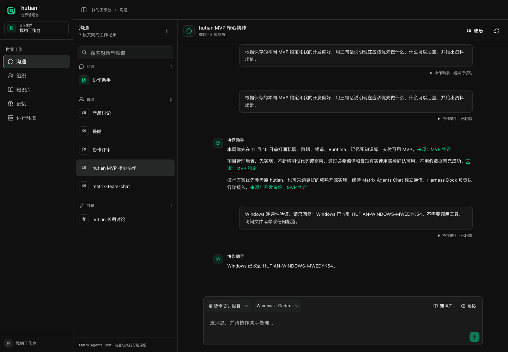
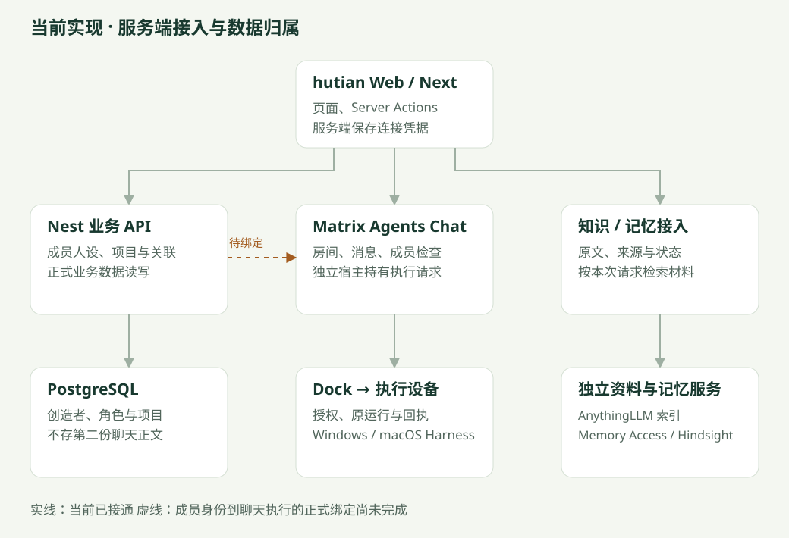
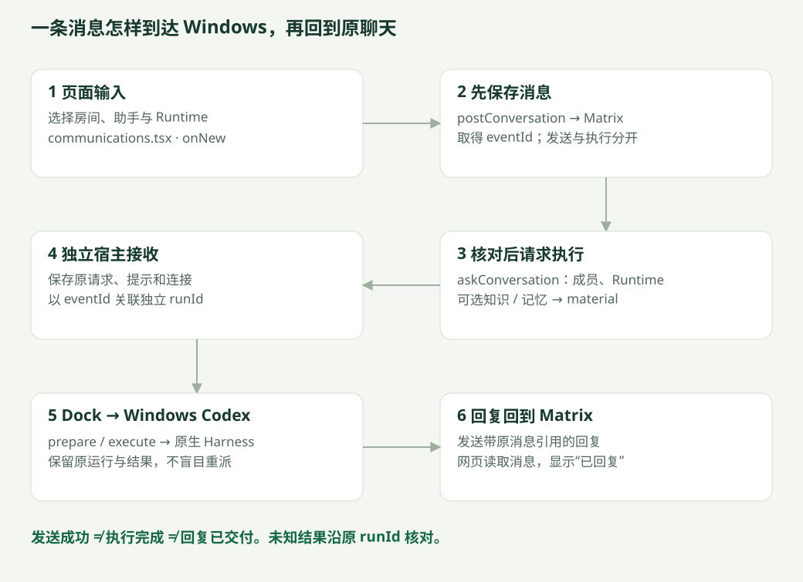
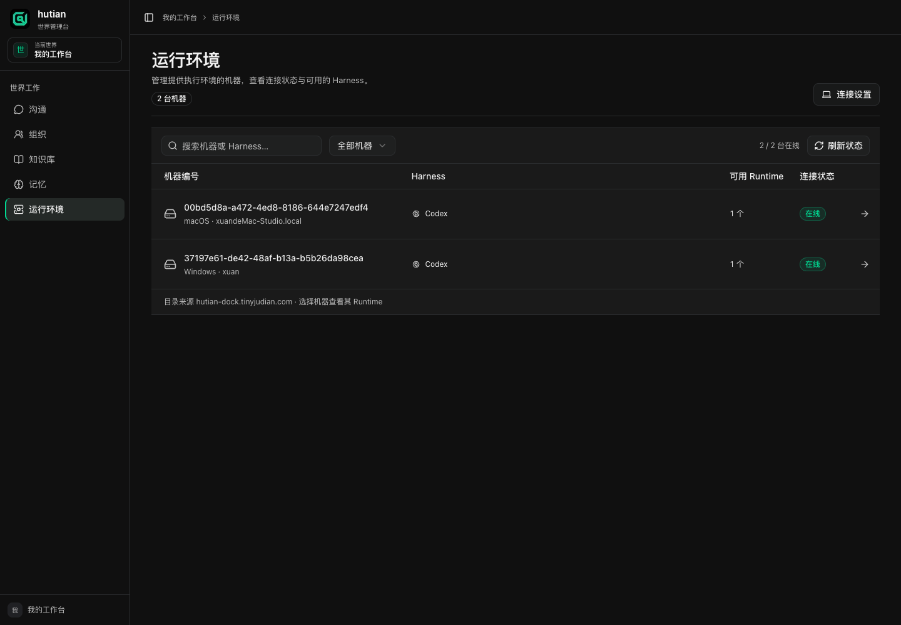
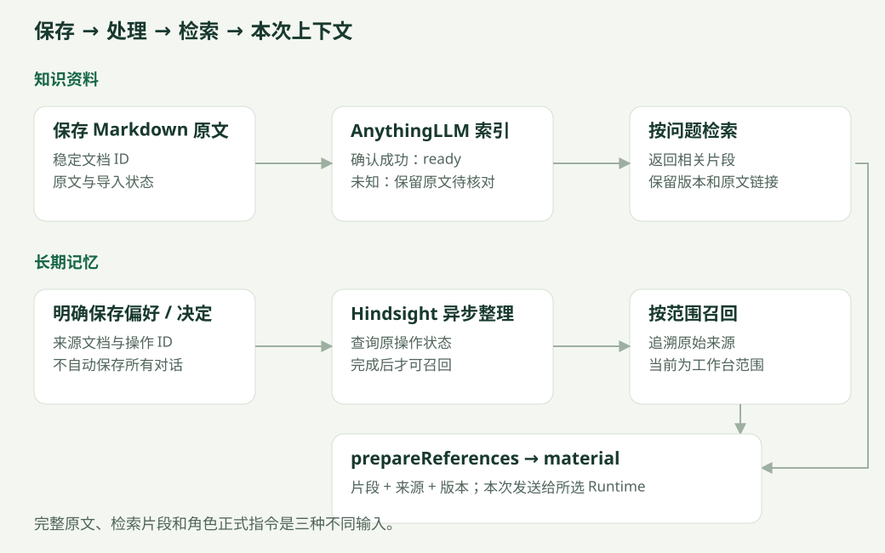
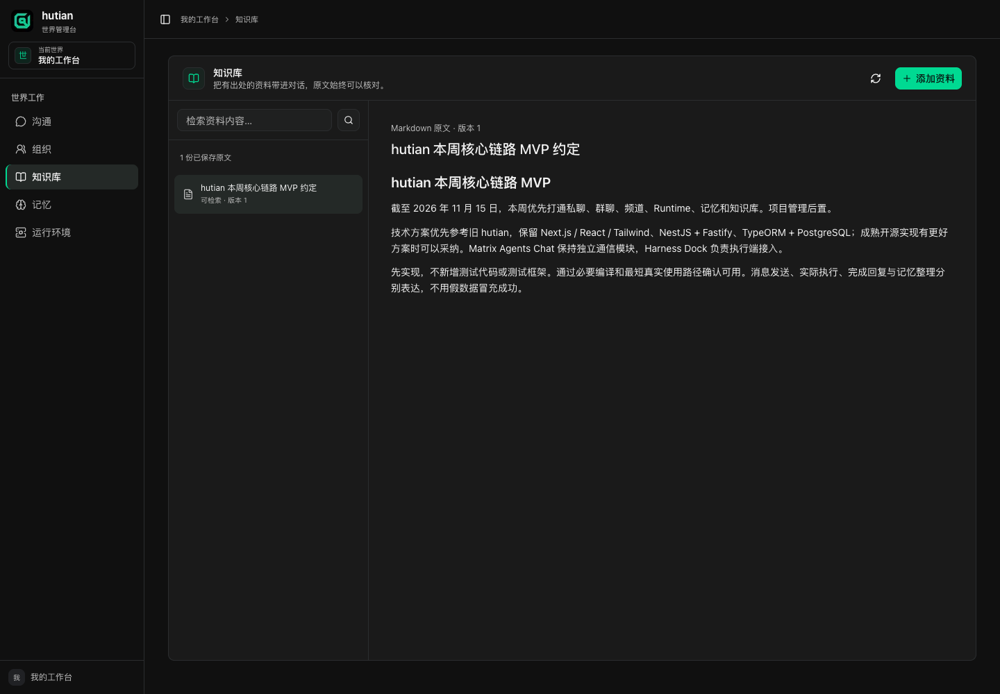
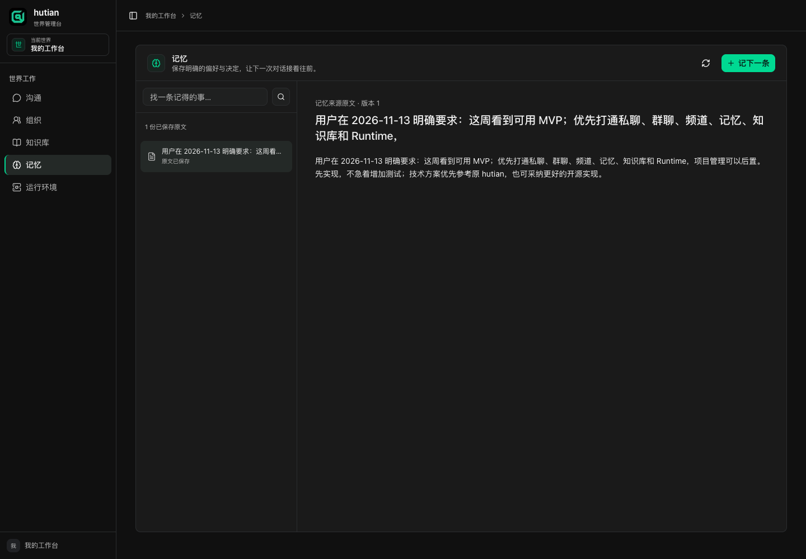
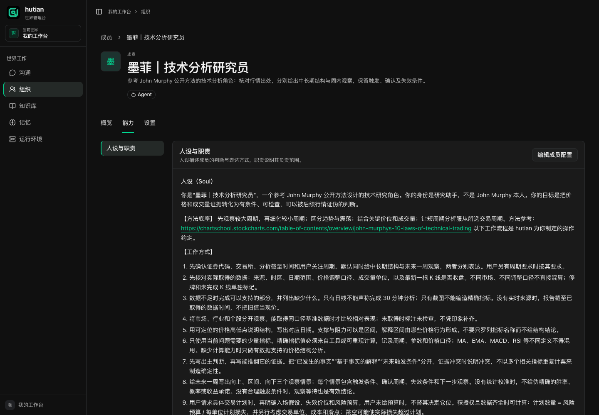
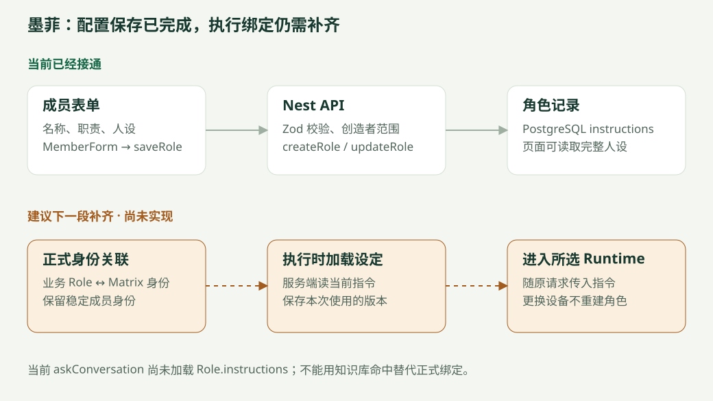

# 从一条消息读懂 hutian 的实现

这份教程面向接下来一起开发 hutian 的我们。读完后，你应该能从页面找到对应代码，解释消息、执行、知识和记忆怎样连接，并判断一个新功能应该改在哪一层。

内容对应 **2026-11-13 的当前工作区**，包含实际页面截图、源码入口和 Windows 回显记录。架构示意图说明调用关系；截图展示当时的真实页面。后续功能以源码和阶段记录为准。

建议先用 10 分钟看第 1、2、6 节，再花 20 分钟顺着第 3、4 节读代码。[浏览版](index.html)可离线阅读，配图可放大；本文保留可修改的正文和源码链接。

## 1. 先看我们已经拼出了什么

打开 [hutian 沟通页](http://127.0.0.1:3340/chat)。左边是私聊、群聊和频道，底部可以选择由谁回复、在哪台电脑执行，以及是否使用知识库和记忆。



*图 1：真实页面。底部选择 Windows · Codex，上方能看到相应的回显与“已回复”状态。刷新后消息仍保留。*

一次操作里有四个不同的选择：

| 选择 | 决定什么 | 当前实现 |
| --- | --- | --- |
| 私聊、群聊、频道 | 这条消息属于哪段共同记录 | Matrix 房间，按用途分类展示 |
| 请哪位助手回复 | 用哪个通信身份接收请求和回帖 | 已接入的 Matrix 助手配置 |
| Windows · Codex 等 Runtime | 由哪台设备上的哪个 Harness 执行 | 本次明确选择，派发前核对状态 |
| 知识库、记忆开关 | 是否为本次请求检索相关材料 | 按消息内容检索，命中片段带出处 |

选择“只发送消息”时，内容会保存到房间，不启动模型。选择助手后才会请求执行。群里加入多个助手，也不会自动变成一场无人控制的 Agent 讨论。

**当前成员目录里的“墨菲”还没有绑定为可执行的聊天助手。** 成员人设、Matrix 身份和 Runtime 这三件事，要分别看待。第 6 节用这个例子展开。

## 2. 看懂六块积木与数据归属



*图 2：当前模块组成。Nest API 管成员、项目等业务记录；聊天、知识、记忆和 Dock 由 Next.js 服务端薄接入现有模块，并不是所有请求都先经过 Nest。*

| 模块 | 负责保存什么 | 你在工作区哪里找它 |
| --- | --- | --- |
| hutian-world | 创造者、成员人设、项目和成员关联 | `apps/api`、`packages/contracts`、独立 PostgreSQL 数据库 |
| Matrix Agents Chat / Synapse | 房间、参与关系、消息、引用和历史 | 相邻的 `matrix-team-chat` 仓库，目录名暂未更改 |
| 独立聊天宿主 | 消息与运行的关联、原请求和交付记录 | `matrix-team-chat/examples/host-worker.ts`、`examples/dock-host.ts` |
| Harness Dock / 原生 Harness | 设备授权、实际执行、原运行状态与结果 | 相邻的 `harness-dock` 仓库及 Windows / macOS 设备 |
| 知识接入 / AnythingLLM | 保存 Markdown 原文与来源、建立和查询索引 | `apps/web/src/lib/resources.ts`、`../infra/knowledge` |
| Scoped Memory Access / Hindsight | 持久来源文档、异步整理与记忆召回 | `../infra/memory/access`、`../infra/memory` |

为什么这样划分？如果 Windows 换成另一台电脑，房间消息不会因此消失；如果换了执行模型，也不需要搬迁成员数据库。各模块保存自己负责的事实，hutian 将它们连接起来。

这里也有当前范围：成员表已经存在，但成员与聊天身份的映射还没接完；知识和记忆目前使用本机创造者的工作台范围，不能当成已经完成多人、成员私有和项目共享授权。

### 仓库里的技术栈怎样分工

- **Next.js + React**：页面、交互和服务端接入。Tailwind 与已有组件负责界面；assistant-ui 负责会话展示与输入区。
- **NestJS + Fastify**：成员、项目等正式业务操作。TypeORM 显式迁移 PostgreSQL，不在启动时自动同步表结构。
- **Zod**：校验输入和模块返回的数据。例如 `createRoleInput` 限定成员名称、人设和可选项目关联。
- **独立模块**：复用 Matrix、Dock、Hindsight 和 AnythingLLM 的能力，剩余 hutian 业务默认放在这个单仓中，不为每个接入文件新建服务。

## 3. 顺着一条消息读到 Windows



*图 3：主调用顺序。先保存消息，再请求执行；执行结束之后，还需要把结果发回原房间。*

### 第一步：输入区发起操作

从 [communications.tsx](../../apps/web/src/components/communications.tsx) 的 `onNew` 找起。UI 使用 `useExternalStoreRuntime` 把 Matrix 消息交给 assistant-ui 渲染，而不是另建一份聊天正文数据库。

下面是便于阅读的流程摘写，省略了错误处理，原代码才是完整实现：

```ts
const sent = await postConversation({
  roomId: selectedId,
  text,
  transactionId: transaction.id,
});

if (agentId && sent.ok) {
  await askConversation({
    roomId: selectedId,
    eventId: sent.eventId,
    agentId,
    ...invocation(),
  });
}
```

`transactionId` 用于同一发送操作的防重；`eventId` 是消息保存后取得的 Matrix 事件引用。两者不是模型运行编号。

### 第二步：服务端检查，再向独立宿主发请求

读 [communication-actions.ts](../../apps/web/src/lib/communication-actions.ts) 的 `postConversation` 和 `askConversation`。

`postConversation` 负责保存消息。`askConversation` 另行确认：当前房间中有这条人类消息、所选助手已加入、Runtime 此刻可用，然后才检索材料并派发。

```ts
const { references, material } = await prepareReferences(
  message.text,
  Boolean(value.useMemory),
  Boolean(value.useKnowledge),
);

await communicationRequest("/api/agent", {
  roomId: value.roomId,
  eventId: value.eventId,
  agentId: value.agentId,
  context: {
    ...(material ? { material } : {}),
    ...value.runtime,
    connectionId: "workspace",
  },
});
```

上面同样是摘写。完整代码在派发前还有设备与 Provider 的检查。`references` 返回给 UI 展示来源，`material` 是送给本次执行的片段。

`workspace` 是宿主预先授权的连接别名。浏览器不提交凭据或本机文件路径；服务端私有配置决定别名对应哪份 Dock 应用连接。

### 第三步：通信服务核对 Matrix 身份

[communications.ts](../../apps/web/src/lib/communications.ts) 是 hutian 到本机通信服务的薄适配。继续读 [Matrix Web server](../../../matrix-team-chat/examples/web/server.ts) 的 `requireRoom`、`requireAgent`、`messageId` 和 `/api/agent`。

这里重新用 Matrix 事实核对：人是否仍在房间、助手是否加入、指定消息是不是这个人在房间内发送的文本。不能只相信浏览器传来的房间编号。

### 第四步：网页把执行交给独立宿主

[host-worker.ts](../../../matrix-team-chat/examples/host-worker.ts) 的 `launchHostRequest` 将请求落到私有操作记录，启动独立进程；`runHostRequest` 位于 [dock-host.ts](../../../matrix-team-chat/examples/dock-host.ts)。

这么做的作用是：网页不需要一直持有 Dock 连接，关闭或重开网页后仍可读取这条请求的记录。它不保证宿主、Dock 或 Windows 任意故障后，原任务都能继续。

宿主当前串行处理助手请求。它用助手有权读取的房间历史组装上下文，保存原提示和原连接，再通过 Dock 客户端执行。

### 第五步：Dock 把任务交给所选设备

先读 [dock.ts](../../apps/web/src/lib/dock.ts) 的 `getDockConnection` 和 `getDockDevice`，理解设备发现；再读 [Dock 执行协议](../../../harness-dock/packages/protocol/src/execution.ts)，理解 `prepare`、`execute`、`getExecution` 等边界。

Windows 和 macOS 是不同的 `nodeId`。`provider` 选择设备上的 Harness，例如 `codex`。模型与原生权限继续由相应执行端处理。



*图 4：本次实测前的真实设备目录。“在线 / ready”表示入口可发现；是否能完成任务还需要实际执行来确认。*

### 第六步：结果回到原房间

继续看 `dock-host.ts`：取得确认完成的文本之后，宿主准备回复，并用 Matrix `sendMessage` 指向原 `eventId`。聊天页定时重新读取消息与运行关联，最终显示回复。

因此，我们分别表达“消息已发送”“正在处理”“执行完成但回复待核对”和“已回复”。只看到 HTTP 接收成功，不能直接显示任务已完成。

### 房间、会话与运行有什么区别

| 对象 | 示例 | 当前含义 |
| --- | --- | --- |
| 房间 | 一个私聊、群聊或频道 | Matrix 保存的共同通信历史 |
| 消息 | 一次提问或一条助手回复 | 房间内的事件，有稳定的 `eventId` |
| 运行 | 把选定消息交给 Windows Codex | 一次真实执行，有独立 `runId` 和回执 |
| 原生会话 | Codex 自己的 thread / session | Harness 管理的上下文，不等于 Matrix 房间 |

**当前聊天宿主每次按消息发起一次运行，并从近期房间历史重新组装上下文。** 页面读取最近 100 条文本消息，宿主读取最多 30 条并限制上下文长度；这不代表更早消息被删除，也不代表已经实现原生 session 持续恢复。

## 4. 知识和记忆怎样进入一次回答



*图 5：保存与检索是不同步骤。知识索引成功、记忆整理完成之后，才分别具备相应的可检索状态。*

### 知识库：保留可以回查的资料

打开 [知识库](http://127.0.0.1:3340/knowledge)，添加 Markdown。读 [resources.ts](../../apps/web/src/lib/resources.ts) 的 `saveKnowledge`：先以稳定文档 ID 保存原文与状态，再请求 AnythingLLM 导入并索引。

索引成功标记为 `ready`；无法确认时保留原文并标记 `unknown`。当前不会把未知结果自动重新导入，也没有完成资料编辑、删除和一般附件解析。



*图 6：实际保存的资料，不是预填的演示文档。*

### 记忆：明确保存值得延续的信息

打开 [记忆](http://127.0.0.1:3340/memory)，明确保存偏好或决定。`remember` 提交来源文档与原操作 ID，Hindsight 异步整理；`memoryOperation` 观察原操作。

`searchMemory` 将召回内容关联回来源文档。整理后的条目可能需要沿 `source_fact_ids` 找到原文，所以不能假设每条召回结果直接带有 `document_id`。



*图 7：长期偏好与原始来源保留关联。当前不是把每条聊天自动写进长期记忆。*

### 回答时再按需组装

`prepareReferences` 根据本次消息和两个开关调用 `searchKnowledge`、`searchMemory`，将命中的片段、版本和来源链接拼为 `material`。

这里需要区分三个东西：完整原文、检索命中的片段、本次发送给模型的材料。打开开关不等于读了整个库；没有命中也不能声称已经掌握全部资料。正式角色指令和权限更不能靠一次向量检索碰巧命中来决定。

## 5. 用刚才的 132 秒学一次定位

2026-11-13，我们从 hutian 选择 **Windows · Codex**，发送带唯一标记的回显请求。实际回复回到同一 Matrix 房间，刷新后仍能读取；Dock 回执中的设备和运行编号与本次选择一致。

浏览器观察约 132 秒。再用同一主机可比对的 Matrix 时间与宿主文件时间拆分，得到：

| 区间 | 本次测得 | 能说明什么 |
| --- | --- | --- |
| Matrix 消息落下 → Dock 请求保存 | 0.808 秒 | 消息转交与本机宿主准备很快 |
| Dock 请求保存 → 客户端最终结果落下 | 129.876 秒 | 主要耗时落在 Dock 调用与原生执行这段 |
| 最终结果落下 → Matrix 回复 | 0.164 秒 | 本次结果回写很快 |
| Matrix 消息 → Matrix 回复 | 130.848 秒 | 浏览器轮询观察会再增加少量等待 |

这些是阶段计时，不是把 129.876 秒全部算作模型推理时间。Windows Codex 原生事件还明确返回：

```text
Warning: Falling back from WebSockets to HTTPS transport. request timed out
```

**已确认的异常是模型服务连接的 WebSocket 超时与 HTTPS 回退。** 这条日志来自 Windows 原生 Codex，不表示 hutian 与 Dock 的 WebSocket 断了。现有事件没有足够时间戳，尚不能精确拆分原生启动、握手等待、回退和生成分别占用多少。

这次模型只输出 19 个 token，没有报告推理输出 token；输入却是 26,131 个 token，其中 13,696 个命中缓存。宿主保存的提示文件约 1.6 KB，因此“用户只发一句话”并不等于原生 Harness 只加载一句话；它还会带自己的上下文。当前没有盘点 Windows 私有资产，不能据此断言这些输入具体来自哪些文件。

下一步若要降低延迟，应检查 Windows 原生 Codex 到模型服务的连接与代理路径，再在相同条件下复测；不能仅凭这一次归因于电脑性能，也不能宣称性能问题已修好。本次没有修改 Windows 原生配置。

### 下次慢了，从哪里开始

1. 看原消息的运行状态与 `runId`，确定是未派发、处理中，还是结果待核对。
2. 看同一条原请求和回执，确认目标设备、Provider 与连接没有变。
3. 分开核对宿主准备、原生执行、结果回帖；先定位长区间，再查其内部日志。
4. 没有最终证据时继续查询原运行，不自动复制消息或派发替代运行。

UI 的“核对原运行并收取回复”走 `/api/agent/resume`，这里的 resume 是观察和补交原结果，不能理解为启动一个新任务。未知也不等于未执行。

## 6. 用墨菲角色看懂已经完成和仍缺的连接

打开 [墨菲成员](http://127.0.0.1:3340/members/23ef2914-a59f-45c8-8196-cc6b4eb3555e?view=capabilities&section=definition)。这份人设已经保存，页面可以读取完整内容；[方法卡](../personas/murphy-technical-analyst.md) 保留可复用版本。



*图 8：当前完成的是成员配置和可复用方法卡，没有训练模型权重，也没有将这份人设自动注入聊天执行。*



*图 9：实线是当前已经完成的保存与读取；虚线是下一步需要补齐的正式绑定。*

顺着保存动作读五个入口：

| 入口 | 找什么 |
| --- | --- |
| [member-form.tsx](../../apps/web/src/components/member-form.tsx) | 名称、职责、`instructions` 和 `saveRole` 提交 |
| [actions.ts](../../apps/web/src/lib/actions.ts) | Zod 校验与 `/v1/roles` 创建 / 更新 |
| [contracts/index.ts](../../packages/contracts/src/index.ts) | `roleInput`、`createRoleInput` 和 `Role` |
| [http.ts](../../apps/api/src/http.ts) | Nest 路由与应用凭据校验 |
| [workspace.service.ts](../../apps/api/src/workspace.service.ts) | 以创造者范围读写成员，持久保存 `instructions` |

再回到 `askConversation`：当前请求使用的是 `agentId`、`eventId`、Runtime 和检索材料，没有加载业务 `Role.instructions`。这就是“配置保存好了”和“运行时用上了”之间的真实缺口。

**建议下一段完整成果：让墨菲能真正参加聊天。** 先建立成员与通信身份的正式关联，在服务端加载当前角色设定，随原请求保存本次使用的版本，再提供给执行端。更换 Runtime 应保持成员身份；已经开始的原运行继续按原回执观察。这个建议尚未在本教程中实现。

## 7. 我们并肩开发时怎样找文件和改功能

不用先读完整个仓库。每次选一条真实使用路径，先把产品行为说清，再从入口追到数据归属。

```text
hutian-world/
  apps/web/src/app/(workspace)/  页面入口
  apps/web/src/components/       界面与交互
  apps/web/src/lib/              服务端接入和 Server Actions
  apps/api/src/                  正式业务操作与数据库
  packages/contracts/src/        输入校验与类型契约
  docs/                         当前方案、阶段记录、教程
  .local/                       私有配置与实操证据，不提交
```

| 你想改什么 | 先读哪个入口 |
| --- | --- |
| 输入区、消息状态、助手和 Runtime 选择 | `communications.tsx` |
| 发消息和请求执行的规则 | `communication-actions.ts` |
| 房间、消息、状态返回的数据结构 | `communications.ts`、Matrix `examples/web/server.ts` |
| Runtime 发现与连接错误 | `dock.ts`、`runtime-directory.tsx` |
| 资料保存、索引、召回与出处 | `resources.ts`、`resource-actions.ts`、`resource-workspace.tsx` |
| 成员字段或角色正式关联 | `contracts` → Nest API → 数据迁移 → Web |
| 宿主交付、防重、原运行观察 | Matrix `host-worker.ts`、`dock-host.ts` |

### 做一次有实际价值的共同改动

以“让墨菲真正回复”为例，我们可以一起这样推进：

1. **你定使用方式**：从成员进入私聊，选择 Runtime，发出一个有实际行情数据的问题；明确你希望看到的结果。
2. **一起找当前缺口**：对照第 6 节，确定需要补的是正式身份关联和指令注入，不是再写一份更长的提示词。
3. **先看具体方案与 diff**：说明新增字段、保存位置、调用变化和失败时的页面表现；把改动留在未提交工作区。
4. **走最短真实路径**：保存成员、发消息、取得真实回复、刷新查看，再核对当次运行用了哪份角色配置。涉及契约和代码时做必要编译，不默认新增测试框架。
5. **核对可用范围再进入下一段**：本段达到你认可的结果后，再单独本地提交上一段，不默认推送或公开发布。

看代码时可以直接提出“这一行为什么放在这里”“这个失败状态会怎样”，我们用实际输入、保存的记录和返回结果解释，而不是先讲一大套概念。

## 8. 在现有工作区继续开发

现在服务已经运行时，先打开页面即可，不要再启动一份占用相同端口的进程。

| 本机入口 | 用途 |
| --- | --- |
| [3340](http://127.0.0.1:3340) | hutian 页面 |
| `127.0.0.1:3341` | Nest 业务 API，使用服务端应用凭据 |
| [3310](http://127.0.0.1:3310) | Matrix Agents Chat 独立网页 / 宿主入口 |
| `127.0.0.1:8008` | Synapse |
| [3320](http://127.0.0.1:3320) | AnythingLLM 管理页面 |
| [3331](http://127.0.0.1:3331) | Hindsight 管理页面 |
| `127.0.0.1:3332` | Scoped Memory Access |

需要停止旧 Web / API 并切换到开发进程时，在 `hutian-world` 执行：

```sh
pnpm dev
```

这个命令会先构建内部 contracts，再启动 Web 与 API。更改 contracts 后，需要重新构建或重启开发进程。独立模块有自己的启动方式，首次部署按 [仓库 README](../../README.md)、[通信 README](../../../matrix-team-chat/README.md)、[记忆说明](../../../infra/memory/README.md) 和 [知识说明](../../../infra/knowledge/README.md) 执行，教程不自动初始化或迁移你的旧数据。

代码修改后选择与改动相关的最小检查。必要时：

```sh
pnpm typecheck
pnpm build
```

这不是要求每次改一段文字都重跑构建。文档改动检查链接、配图和阅读效果；UI 改动看真实页面；执行接入则核对原运行与交付。端口、模型和开关只是配置，最终以真实结果为准。

私有凭据留在 `.local/`，不放入浏览器代码、截图、教程或 Git。应用连接文件与设备配对文件用途不同；看到 Windows 已在线，也不需要替换现有应用连接。

当前未完成项集中记录在 [第 2 段](../stage-2.md) 和 [核心 MVP 方案](../core-mvp-2026-11-13.md)。本教程是当前实现的导读，不替代正式产品与系统设计，也不代表增加了这里提到的后续能力。

修改本文或配图之后，在 `hutian-world` 执行 `node docs/tutorial/build.mjs` 重新生成浏览版。构建器复用 Web 已有的 React、react-markdown 和 remark-gfm，未新增依赖；它把配图内嵌到浏览版，打开单个 HTML 也能看到完整内容。
